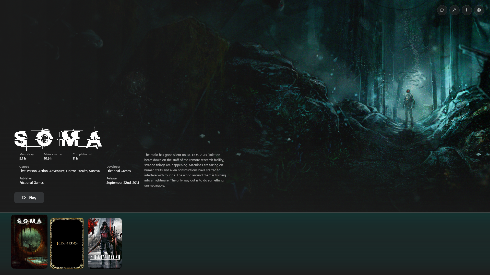
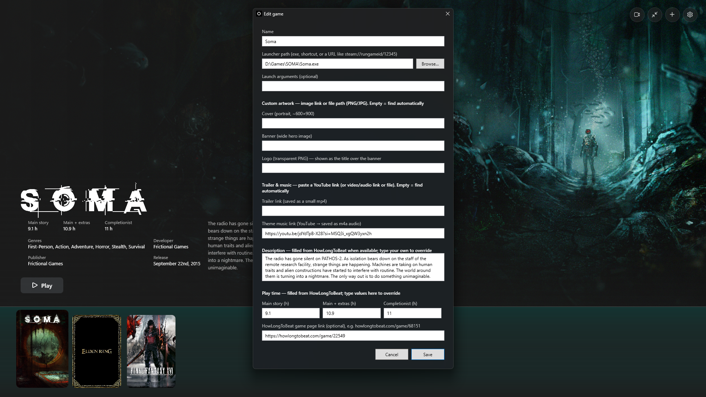
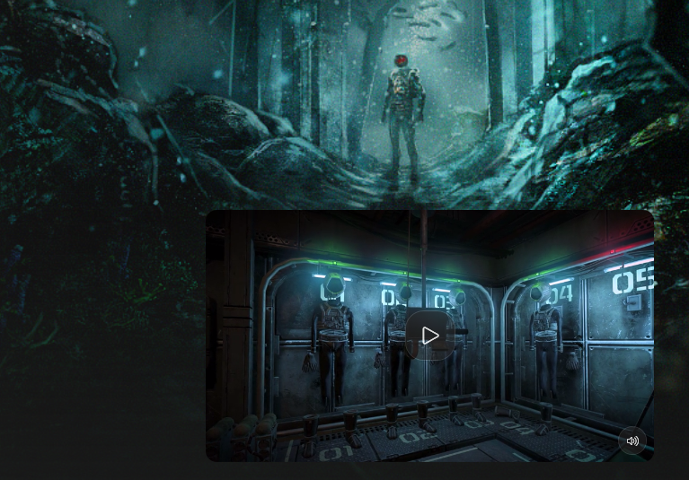

# Lumen

Dark, controller-friendly WPF game launcher with hero art, a corner trailer, and per-game media.

## Features

- Clean dark UI with banner art, logo/title, fixed description box with scroll
- Shelf with cover tiles (favorites first)
- Trailer in bottom-right corner (A play/pause, Y show/hide, X mute)
- Theme music per game, fades with trailer/game launch
- Controller support, one-instance-per-game, hours from HowLongToBeat with manual override
- Artwork/logo from links or SteamGridDB (optional API key)

## Quick start

1. Run `Lumen.exe` (or `build.bat` to publish to `dist/`)
2. Press `+` to add a game (path + optional cover/banner/logo/trailer/music links)
3. Use gamepad: `◀ ▶` browse, `▲ ▼` scroll description, `START` play, `A` play trailer, `Y` show trailer, `X` mute, `B` back

## Screenshots

